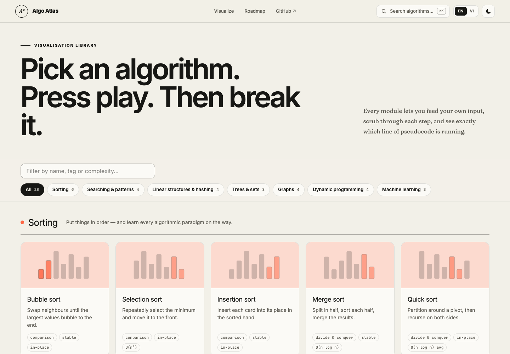
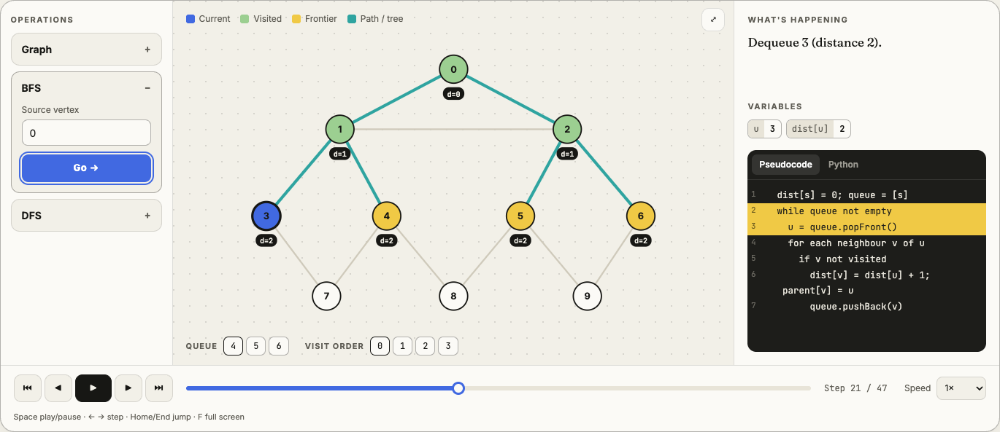
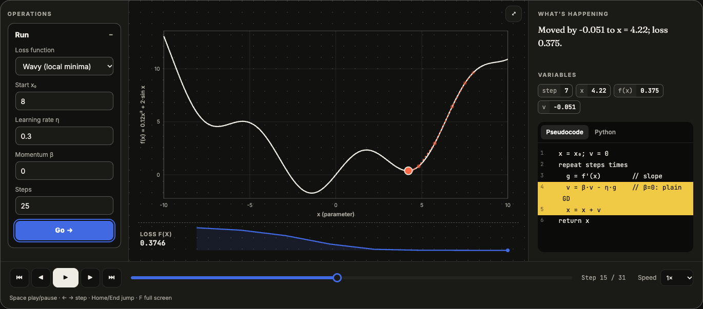

# Algo Atlas · English / Tiếng Việt

**Learn the ideas. Watch them work.**
Interactive, step-by-step visualisations of algorithms, data structures and machine learning — with pseudocode, live variables, real-world applications and practice problems, in English and Vietnamese.

**Hiểu ý tưởng. Xem chúng vận hành.**
Mô phỏng tương tác, từng bước, về thuật toán, cấu trúc dữ liệu và học máy — kèm mã giả, biến trực tiếp, ứng dụng thực tế và bài luyện tập, bằng tiếng Anh và tiếng Việt.



## What's inside · Có gì bên trong

**28 interactive visualisations** in 7 tracks · **28 mô phỏng tương tác** trong 7 mảng:

| Track · Mảng | Visualisations · Mô phỏng |
|---|---|
| Sorting · Sắp xếp | Bubble, selection, insertion, merge, quick, counting sort |
| Searching & patterns · Tìm kiếm & mẫu tư duy | Linear search, binary search, two pointers, sliding window |
| Linear structures & hashing · Cấu trúc tuyến tính & băm | Stack (+ bracket checker), queue, linked list, hash table (chaining / linear probing) |
| Trees & sets · Cây & tập hợp | Binary search tree, binary heap & heap sort, union-find |
| Graphs · Đồ thị | BFS & DFS, Dijkstra & Bellman–Ford, Kruskal & Prim, topological sort |
| Dynamic programming · Quy hoạch động | Coin change, 0/1 knapsack, longest common subsequence, edit distance |
| Machine learning · Học máy | Gradient descent (with momentum), linear regression, k-means / k-means++ |

### Every visualisation page has · Mỗi trang mô phỏng có

- **Operations panel** — create your own input (random, sorted, reversed, custom…) and run any operation, VisuAlgo-style.
  **Bảng thao tác** — tự tạo dữ liệu và chạy từng thao tác.
- **Player** — play/pause, step forward/back, scrubbable timeline, speed 0.25×–4×, full screen.
  **Trình phát** — phát/dừng, tiến/lùi từng bước, thanh tua, tốc độ, toàn màn hình.
- **Highlighted pseudocode + live variables** — see exactly which line runs and what `i`, `lo`, `dist[v]`… hold at each step, with a plain-language explanation.
  **Mã giả được tô sáng + biến trực tiếp** — thấy dòng nào đang chạy và giá trị biến ở mỗi bước.
- **Python reference implementation** with a copy button.
  **Cài đặt Python tham khảo.**
- **Apply it** — real-world uses, how to recognise the pattern in a problem, common pitfalls, ordered practice problems, and a short quiz.
  **Áp dụng** — ứng dụng thực tế, cách nhận diện trong đề bài, lỗi thường gặp, bài luyện tập và câu hỏi tự kiểm tra.



Also · Ngoài ra: ⌘K / `/` search, EN ↔ VI switch, light/dark theme, mobile layout, and a live quick-sort demo on the home page.



## Quick start · Bắt đầu nhanh

Requires Node.js ≥ 22.13 · Cần Node.js ≥ 22.13

```bash
npm install
npm run dev          # http://localhost:3000
```

| Command · Lệnh | What it does · Chức năng |
|---|---|
| `npm run dev` | Development server with hot reload · Máy chủ phát triển |
| `npm run build` | Production build (Cloudflare Worker via vinext) · Bản build production |
| `npm start` | Serve the production build · Chạy bản build |
| `npm test` | Build, then run all tests in `tests/` · Build rồi chạy kiểm thử |
| `npm run lint` | ESLint |

Keyboard shortcuts on a visualisation page · Phím tắt:

| Key · Phím | Action · Hành động |
|---|---|
| `Space` / `K` | Play / pause · Phát / dừng |
| `←` `→` (or `J` `L`) | Step back / forward · Lùi / tiến một bước |
| `Home` / `End` | First / last step · Bước đầu / cuối |
| `F` | Full screen · Toàn màn hình |
| `⌘K` or `/` | Search algorithms · Tìm thuật toán |

## How it works · Cách hoạt động

Each algorithm runs once on your input and **records a snapshot at every decision** (state, highlighted pseudocode line, bilingual note, variables). A shared player then replays those snapshots, so stepping backwards is free and every frame is exact.

Mỗi thuật toán chạy một lần trên dữ liệu của bạn và **ghi lại ảnh chụp ở mỗi quyết định**. Trình phát dùng chung sẽ phát lại các ảnh chụp đó, nên lùi bước không tốn chi phí và mọi khung hình đều chính xác.

```text
app/
├── page.tsx                     # Home: hero, searchable catalog, roadmap
├── visualize/[slug]/page.tsx    # One route per visualisation
├── components/
│   ├── Visualizer.tsx           # Player: operations, canvas, pseudocode, controls
│   ├── LearnContent.tsx         # Applications, pitfalls, practice, quiz, Python
│   └── views/                   # Renderers: Array, Graph, Tree, Grid (DP), List, Hash, Plot
└── lib/
    ├── types.ts                 # VizModule / Action / Step contracts
    ├── registry.ts              # All modules + categories
    └── modules/                 # sorting, searching, linear, hashing, trees, graphs, dp, ml
python/algo_atlas/               # Plain-Python implementations + unit tests
lessons/                         # Bilingual concept notes
CURRICULUM.md                    # 24-week study plan
```

### Add a new visualisation · Thêm mô phỏng mới

1. Write a `VizModule` in `app/lib/modules/` — content (intro, invariant, complexity, applications, pitfalls, practice, quiz, Python) plus `actions` whose `run()` returns `{ steps, model }`.
2. Reuse a renderer by setting `view` (`array`, `graph`, `tree`, `grid`, `list`, `hash`, `plot`) and producing that view's state type from `app/lib/views.ts`.
3. Add the module to `app/lib/registry.ts`. It appears in the catalog, search and routing automatically.
4. Run `npm test` — every page is server-rendered and checked.

### JSON API

The Cloudflare Worker also exposes the traces as JSON · Worker cũng cung cấp dữ liệu dạng JSON:

```text
GET  /api/health
GET  /api/modules
GET  /api/modules/:slug
POST /api/modules/:slug/run      body: { "action": "sort", "values": { ... } }
```

The API reads from `app/lib/catalog.ts`, which uses the same registry as the website, so all 28 modules are available.

## Study with it · Cách học

Follow the [24-week curriculum](./CURRICULUM.md) (the home page roadmap links each phase to its visualisations). For every topic:

Theo [chương trình 24 tuần](./CURRICULUM.md). Với mỗi chủ đề:

1. **Watch · Xem** — run the default example to build a picture.
2. **Trace · Lần vết** — pause and predict the next highlighted line before stepping.
3. **Apply · Áp dụng** — read where it is used and how to spot it in a problem.
4. **Test · Kiểm tra** — answer the quiz, try edge-case inputs, solve the practice problems.

Then implement it yourself in Python and compare with `python/algo_atlas`:

```bash
python3 -m unittest discover -s python/tests -v
```

Study principles · Nguyên tắc học:

- Implement before importing. / Tự cài đặt trước khi dùng thư viện.
- Test empty, one-item, duplicate and extreme inputs. / Kiểm thử dữ liệu rỗng, một phần tử, trùng lặp và cực trị.
- Ask four questions: contract, invariant, cost, trade-off. / Hỏi bốn câu: bài toán, bất biến, chi phí, đánh đổi.
- Explain it aloud in both languages. / Tự giải thích bằng cả hai ngôn ngữ.

## Contributing · Đóng góp

Issues and pull requests are welcome — new visualisations, clearer explanations, better Vietnamese terminology, or bug fixes. Vietnamese terms follow common university usage, keeping English terms where they are industry standard.

Hoan nghênh issue và pull request — mô phỏng mới, giải thích rõ hơn, thuật ngữ tiếng Việt tốt hơn hoặc sửa lỗi. Thuật ngữ tiếng Việt theo cách dùng phổ biến ở đại học; giữ thuật ngữ tiếng Anh khi là chuẩn trong ngành.

> This is a broad, growing map — not a promise that a finite repository can contain every algorithm ever invented.
> Đây là một bản đồ kiến thức rộng và luôn phát triển — không phải tuyên bố chứa mọi thuật toán từng được phát minh.
